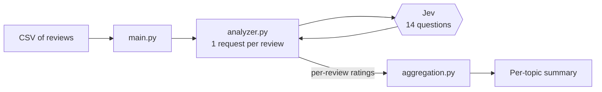

#  Smartphone Review Analyzer

> Turn messy, free-text smartphone reviews into clean **Flipkart-style per-topic star ratings** — powered by **Jev** via the TypeSafe SDK.


A single overall star rating hides the details. Someone may love the camera but hate the battery. This project reads each review, figures out **which topics it talks about** and **how satisfied the reviewer was with each one**, then rolls everything up into a per-topic summary.

---

##  Features

- **7 topics analyzed automatically:** Camera, Battery, Display, Design, Performance, Build Quality, Value for Money
- **Mention detection:** a topic is rated only if the review actually discusses it, so no made-up ratings
- **Fine-grained scores:** satisfaction is returned on a continuous scale (e.g. `3.4 ★`), not just whole stars
- **One request per review:** all 14 questions are sent to Jev together
- **Simple, readable code:** four small modules, no framework needed

---

##  How it works

For every review, Jev is asked **14 questions**: two for each of the 7 topics.

| Question | Type | Meaning |
|---|---|---|
| `<topic>_mentioned` | `Noul` | Probability (0–1) that the review discusses the topic |
| `<topic>_rating` | `Score` | Reviewer satisfaction on a 5-level scale (0–4), mapped to 1–5 stars |

A topic's rating is **kept only if the mention probability is ≥ `0.5`**. Kept ratings are then averaged across all reviews.



### Satisfaction scale

| Level | Meaning | Stars |
|:---:|---|:---:|
| 0 | Very dissatisfied | 1 ★ |
| 1 | Dissatisfied | 2 ★ |
| 2 | Neutral / balanced mixed feedback | 3 ★ |
| 3 | Satisfied | 4 ★ |
| 4 | Very satisfied | 5 ★ |

Jev can return values in between (e.g. `3.4`), which is why you'll see decimal ratings.

---

##  Project structure

```
.
├── main.py                       # Reads the CSV, analyzes reviews, prints the summary
├── analyzer.py                   # Sends one review to Jev, converts answers to stars
├── questions.py                  # Topic list + the 14 Jev questions
├── aggregation.py                # Averages per-review ratings into one score per topic
├── synthetic_phone_reviews.csv   # 50 synthetic sample reviews
└── .gitignore
```

| File | Purpose |
|---|---|
| `main.py` | Entry point. Loads reviews, loops over them, prints the final report |
| `analyzer.py` | Calls `client.system_one(...)` with model `jev-latest` and applies the mention threshold |
| `questions.py` | Defines `TOPICS`, the satisfaction levels, and all `Noul` / `Score` questions |
| `aggregation.py` | Collects each topic's stars across reviews and returns `{average, count}` |

---

##  Getting started

### 1. Install dependencies

```bash
pip install python-dotenv typesafe-sdk
```

### 2. Add your API key

Create a `.env` file in the project root:


>  `.env` is already listed in `.gitignore`, so your key won't be committed.

### 3. Run it

```bash
python main.py
```

### Example output

```
R001 {'Camera': 4.6, 'Battery': 4.2, 'Performance': 4.3, 'Value for Money': 4.5}
R002 {'Battery': 1.8}
...

3.4 ★  based on 50 ratings
----------------------------------------
Camera           3.8 ★  (21 reviews)
Battery          2.9 ★  (24 reviews)
...
```

- The first block shows the ratings found in each individual review.
- The headline number is the average of the reviewers' own overall ratings.
- The table below it shows the average Jev-derived rating per topic and how many reviews mentioned it.
- A topic nobody mentioned is shown as `no ratings yet`.

---

##  Input format

Your CSV must contain these columns:

| Column | Description |
|---|---|
| `review_id` | Unique review ID |
| `phone_model` | Phone name |
| `overall_rating` | Integer 1–5 star rating given by the reviewer |
| `review_text` | The review body (this is what gets analyzed) |
| `is_synthetic` | Whether the review was generated |

To use your own data, change `INPUT_FILE` at the top of `main.py`:

```python
INPUT_FILE = "your_reviews.csv"
```

---

## Customization

**Change the mention threshold** (`analyzer.py`): raise it for stricter topic detection, lower it to capture weaker mentions.

```python
MENTION_THRESHOLD = 0.5
```

**Add a new topic** (`questions.py`):

1. Add it to `TOPICS`, e.g. `"Software": "software"`
2. Add a `<id>_mentioned` (`Noul`) and `<id>_rating` (`Score`) question to `QUESTIONS`

No changes are needed in `analyzer.py` or `aggregation.py`, since they loop over `TOPICS`.

---

##  About the sample data

`synthetic_phone_reviews.csv` contains **50 synthetic reviews** (flagged with `is_synthetic = true`) so you can try the pipeline right away without collecting real data.

---

##  Built with

- [Python](https://www.python.org/)
- **Jev** through the **TypeSafe SDK** (`typesafe-sdk`)
- [`python-dotenv`](https://pypi.org/project/python-dotenv/) for loading the API key
